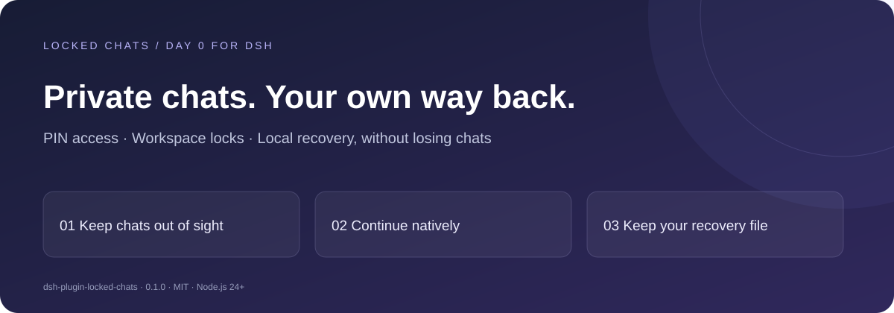
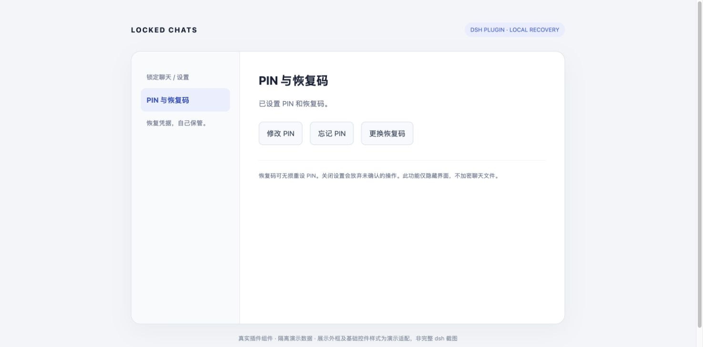
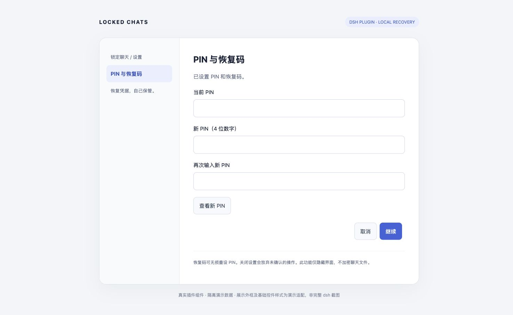
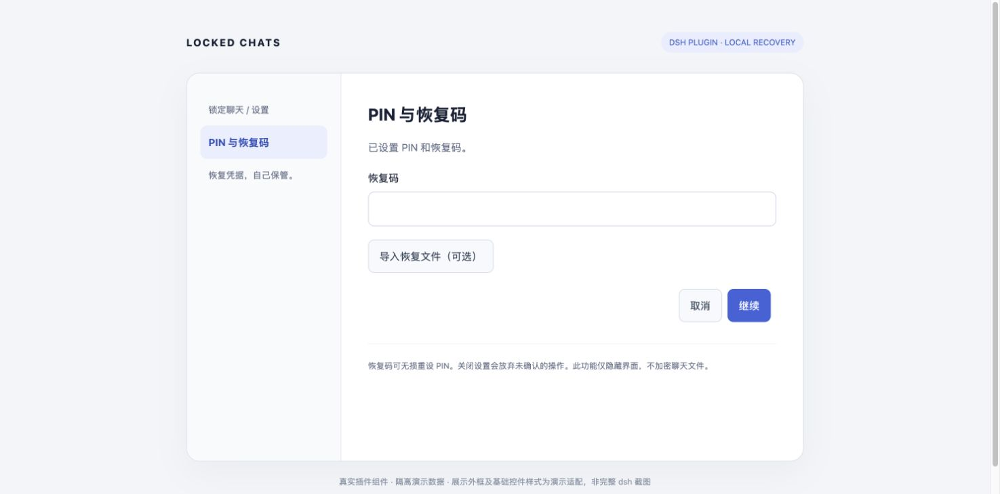

<div align="center">

# Locked Chats for dsh

### Keep private chats out of sight. Keep recovery in your hands.

**Day 0 for dsh · Four-digit PIN · Workspace locks · Local recovery files**

[](https://www.npmjs.com/package/dsh-plugin-locked-chats)
[](LICENSE)
[](plugin/package.json)

[简体中文](README.md) · **English**

[Install](#start-in-a-minute) · [Screenshots](#local-control-you-can-see) · [Compare with Codex](#compared-with-codex-familiar-workflows-local-recovery) · [User guide](plugin/README.md)

</div>



Sharing your screen without sharing every chat title? Mixing everyday development with private discussions in the same project? Forgot your PIN but want to keep your conversations?

**Locked Chats adds everyday interface privacy to DeepSeek Harness Web. Open your locked chats with a PIN, continue the original conversation, and regain access with a recovery file you saved yourself.**

One plugin. One install command. No dsh source changes. Release `0.1.1` includes chat hiding, workspace locks, recovery files, and separate local memory domains for the plugin, and fixes unlock failures caused by expired window credentials after inactivity or a Host restart.

> Interface privacy, not disk encryption. Designed to reduce accidental exposure during everyday use; it does not block someone with file, API, or device access.

## Why install it?

| Your situation | What Locked Chats does |
| --- | --- |
| Private chat titles should stay out of a screen share | Hide selected chats from supported history, pinned, and search surfaces |
| A whole project needs privacy | Lock a workspace, including existing, future, and descendant chats |
| You still want a full conversation experience | Continue with dsh's native conversation, composer, attachments, model controls, and permission interactions |
| You forgot the PIN | Import your saved recovery file, verify it, and reset the PIN without deleting chats |
| Private memories should not surface in ordinary chats | Separate ordinary and private memory in the plugin's own memory tool |

**The key benefit: you hold the recovery credential.** Download a recovery file during setup and store it separately. Import it if you forget the PIN. The plugin does not store plaintext recovery codes by default, and a recovery file is not a backup of your chats.

## Start in a minute

Requires **dsh 0.2.1-rc.2**. Choose the installation method for your client.

### Desktop

Open **Plugins → Add plugin** in the desktop sidebar and enter this package spec. After installation, choose **Enable now** and restart the app:

```text
dsh-plugin-locked-chats@0.1.1
```

Alternatively, install with the command provided by the desktop app:

1. Launch the desktop app once and register its command from the application menu: **Manage dsh Command… → Install**.
2. **Fully quit the app** (closing the window keeps it running in the background), then open a new terminal and run:

   ```sh
   dsh plugin --profile desktop add dsh-plugin-locked-chats@0.1.1
   ```

3. Reopen the desktop app.

Desktop bundles its runtime. For command-line installation, use the desktop-registered `dsh` above; an npm-installed global `dsh` cannot manage the desktop profile. See the [official Desktop guide](https://github.com/deepseek-ai/deepseek-harness/blob/master/apps/desktop/README.md).

### Web

Requires **Node.js 24+**. Run:

```sh
dsh plugin --profile web add dsh-plugin-locked-chats@0.1.1
```

Restart the corresponding dsh profile and refresh the Web interface. Plugin installations in `web` and `desktop` are independent; install into the profile used by your client.

### Upgrade from 0.1.0

Fully quit Desktop, run the `--profile desktop add` command above using the desktop-registered `dsh`, then reopen the app. For Web, run the `--profile web add` command above, restart that profile, and refresh the page. These steps also replace the earlier local fix package.

Upgrading preserves existing chats, PINs, and recovery codes. No credential reset is needed. After an idle window expires, enter your PIN again to reconnect. See the [0.1.1 release notes](plugin/CHANGELOG.md).

### First use

1. Open a chat menu and choose **锁定聊天** (Lock chat).
2. Set a four-digit PIN. **Download and safely store the recovery file**, then enter its code to confirm the backup.
3. Open **锁定聊天** below the workspace heading, enter your PIN, and continue. Choose **立即上锁** to lock again when finished.

For a whole project, choose **锁定工作区** inside the vault. Future chats in that workspace are included automatically. The plugin UI currently uses Chinese.

## Local control you can see

These are **isolated demonstrations of the actual 0.1.0 settings component**, not full dsh host screenshots. The presentation frame and base-control styling are demo adaptations. No real chats, PINs, or recovery codes are shown; host themes may look different.

### 01 · One place for PINs and recovery

Change your everyday PIN, recover access, or rotate your recovery credential.



### 02 · Change your PIN, keep your conversations

Verify the current PIN and enter a new one. Reveal or hide the new PIN to reduce typing mistakes.



### 03 · Forgot the PIN? Import your local recovery file

Verify the recovery credential, set a new PIN, then save and confirm a fresh recovery backup.



## Compared with Codex: familiar workflows, local recovery

**This comparison covers chat organization and privacy workflows, not model performance or the entire Codex product.** Keep the project-and-chat habits familiar from Codex; add a focused privacy and recovery workflow to dsh.

| Capability / experience | Codex comparison baseline | dsh + Locked Chats 0.1.0 |
| --- | --- | --- |
| Project-based chats and continuing existing conversations | Documented project and chat management | **Aligned experience:** keeps dsh workspaces and native conversations |
| Native input, attachments, and interaction patterns | Codex's own native workflow | **Aligned experience:** reuses dsh components, not a claim of identical cross-product APIs or features |
| Four-digit PIN and hidden chats | Specific locking mechanism not confirmed in the reviewed public docs | **Implemented:** lock, unlock, continue, and relock |
| Workspace and future-chat inheritance | Equivalent rules not confirmed | **Implemented:** existing, future, and descendant chats are covered |
| Locally saved recovery credentials and non-destructive PIN reset | Equivalent local-file recovery workflow not confirmed | **Core differentiator:** download, keep, and import your own recovery file |
| Separate private and ordinary memory | Codex-wide memory is not treated as an equivalent implementation | **Explicit scope:** only the plugin's `locked_chats_memory` tool |
| Disk encryption, API isolation, mobile biometrics | Outside this comparison | **Not provided:** PIN-based hiding does not replace these controls |

**The extra step here is recovery you control:** hide the conversation, and keep your own route back to it. Local recovery files, inherited workspace protection, and inspectable plugin code are concrete benefits. Unverified Codex features are not labeled “missing,” and this is not a claim of overall superiority.

Comparison checked **2026-10-23** against [OpenAI's projects and chats documentation](https://learn.chatgpt.com/docs/projects?surface=app) and the [ChatGPT / Codex changelog](https://learn.chatgpt.com/docs/changelog). Not confirmed in public documentation does not mean unavailable; features may vary by release or account. This is not an official OpenAI or DeepSeek plugin.

## Recover a forgotten PIN

Open **更多 → 设置 → 锁定聊天 → 忘记 PIN** (More → Settings → Locked Chats → Forgot PIN).

1. Import your saved `dsh-locked-chats-recovery.txt`, or enter its recovery code.
2. After verification, choose and confirm a new PIN.
3. Download a fresh recovery file and enter its new code to confirm the backup.
4. Open your locked chats with the new PIN. **Recovery does not delete conversations.**

Keep the recovery file separate from plugin data, for example in a password manager or secure storage you control. **If both the PIN and recovery code are lost, there is no credential-free recovery path.** Local credential storage here means recovery backup, not model API-key storage or chat-encryption key escrow.

## Memory with an explicit boundary

The native `locked_chats_memory` tool remembers, searches, or forgets information when explicitly requested.

- **Ordinary chats:** read and write ordinary memory only.
- **Locked chats:** read ordinary and private memory; additions, changes, and deletions affect private memory only.
- Scope comes from real host session/workspace state, not a session ID or memory domain chosen by the model.

Locking a chat does not retroactively make its old ordinary memories private. Other MCP services, files, and provider memory are outside this boundary.

<details>
<summary><strong>Protection scope, compatibility, and verification</strong></summary>

Hiding applies to supported Web surfaces. Raw APIs, CLI tools, chat files, other clients, and disabling the plugin can bypass it. Existing shares are not revoked; other open windows may need a refresh. This is not a security boundary against device administrators or malicious software.

Validated target: dsh `0.2.1-rc.2`. Other versions, full background-task eligibility controls, account synchronization, and biometrics are unverified or unimplemented.

Build, typecheck, and **69 tests passed** before release. Packed import, service activation, and disposal checks also passed. Isolated tests do not cover every real host scenario.

```sh
cd plugin
npm ci
npm run build
npm run typecheck
npm test
```

[Full English guide](plugin/README.md) · [Changelog](plugin/CHANGELOG.md) · [Report an issue](https://github.com/phao1/dsh-plugin-locked-chats/issues)

</details>

---

**Give private discussions their own place in dsh. [Install Locked Chats.](#start-in-a-minute)**

[MIT](LICENSE) · Made for DeepSeek Harness Web.
