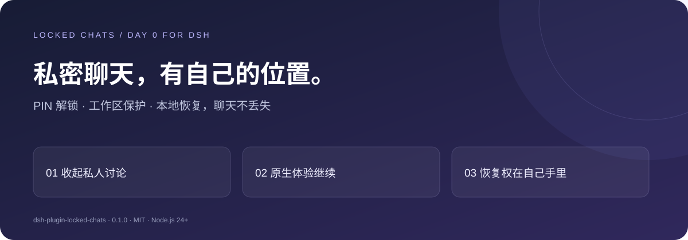

<div align="center">

# Locked Chats for dsh

### 把私密聊天收起来，把恢复权留给自己。

**Day 0 for dsh · 四位 PIN · 工作区锁定 · 本地恢复文件**

[](https://www.npmjs.com/package/dsh-plugin-locked-chats)
[](LICENSE)
[](plugin/package.json)

**简体中文** · [English](README.en.md)

[立即安装](#一分钟开始使用) · [看界面](#看得见的本地控制权) · [与 Codex 对比](#与-codex-对比对齐体验做深本地恢复) · [使用手册](plugin/README.zh-CN.md)

</div>



共享屏幕时，不想让私人聊天标题出现在侧边栏？一个项目里，既有日常开发，也有不适合随手展示的讨论？忘了 PIN，又不想为了恢复访问而丢掉聊天？

**Locked Chats 给 DeepSeek Harness Web 加上一层日常界面隐私：用 PIN 打开锁定区，继续原来的对话；用自己保存的恢复文件，在忘记 PIN 时重新拿回访问权。**

独立插件，一条命令安装，无需修改 dsh 源码。`0.1.3` 发布 English / 简体中文界面，保留 dsh `0.2.1-rc.2` / `0.2.1-rc.3` 兼容及此前的窗口重连、原生新建会话修复。

> 界面隐私，不是磁盘加密。适合减少日常展示中的意外曝光；不能阻止有文件、API 或设备访问权限的人读取数据。

## 为什么值得装

| 你遇到的事 | Locked Chats 的做法 |
| --- | --- |
| 开会共享屏幕，私人聊天标题不想露出来 | 锁定单条聊天，从已适配的普通历史、置顶与搜索入口隐藏 |
| 整个项目都需要收起来 | 锁定工作区，同时覆盖已有、以后新建及派生的聊天 |
| 隐藏之后，还想正常使用 AI | 解锁后继续使用 dsh 原生对话、输入、附件、模型选择和权限交互 |
| 忘了四位 PIN，不想重来 | 导入自己保存的恢复文件，验证后重设 PIN，保留聊天 |
| 私密讨论中的记忆不想混入普通聊天 | 插件记忆工具按真实会话锁定状态区分普通与私密记忆 |

**最有价值的地方：恢复凭据在你手里。** 首次设置时下载恢复文件，单独保存；忘记 PIN 时导入即可进入重设流程。插件默认不保存明文恢复码，恢复文件也不是聊天备份。

## 一分钟开始使用

兼容目标为 **dsh 0.2.1-rc.2 或 0.2.1-rc.3**。按你使用的客户端选择安装方式。

本轮交付 GitHub Release 安装包；npm `0.1.3` 尚未发布。以下链接可直接安装。

### 桌面端

在桌面端侧栏打开 **插件 → 添加插件**，输入以下安装包链接，安装后点击 **立即启用**，再重启桌面端：

```text
https://github.com/phao1/dsh-plugin-locked-chats/releases/download/v0.1.3/dsh-plugin-locked-chats-0.1.3.tgz
```

也可以使用桌面端提供的命令安装：

1. 启动一次桌面端，在应用菜单的 **管理 dsh 命令… → 安装** 中注册命令。
2. **完全退出桌面端**（仅关闭窗口会保留后台进程），打开新终端执行：

   ```sh
   dsh plugin --profile desktop add https://github.com/phao1/dsh-plugin-locked-chats/releases/download/v0.1.3/dsh-plugin-locked-chats-0.1.3.tgz
   ```

3. 重新打开桌面端。

桌面端自带运行时。命令行安装请使用上述桌面端注册的 `dsh`；npm 全局安装的 `dsh` 不能管理桌面端 profile。参见 [官方桌面端说明](https://github.com/deepseek-ai/deepseek-harness/blob/master/apps/desktop/README.zh.md)。

### Web 端

需要 **Node.js 24+**，执行：

```sh
dsh plugin --profile web add https://github.com/phao1/dsh-plugin-locked-chats/releases/download/v0.1.3/dsh-plugin-locked-chats-0.1.3.tgz
```

重启对应 dsh profile，刷新 Web 页面。`web` 和 `desktop` 的插件安装独立，使用哪个客户端就安装到对应 profile。

### 从 0.1.0 / 0.1.1 / 0.1.2 升级

完全退出桌面端后，用桌面端注册的 `dsh` 执行上方 `--profile desktop add` 命令，再重新打开应用；Web 端执行上方 `--profile web add` 命令后重启对应 profile 并刷新页面。这也适用于此前安装的本地修复包。

升级保留现有聊天、PIN 和恢复码，无需重新设置。闲置过期后再次输入 PIN 即可重新连接。完整变更见 [0.1.3 版本说明](plugin/CHANGELOG.md)。

### 开始使用

1. 打开某条聊天的菜单，选择 **锁定聊天**。
2. 首次使用时设置四位 PIN，**下载并妥善保存恢复文件**，回填恢复码确认备份。
3. 从工作区标题下的 **锁定聊天** 入口输入 PIN，继续聊天；离开前点击 **立即上锁**。

想保护整个项目？在保险箱中选择 **锁定工作区**。以后在该工作区新建的聊天也会被纳入保护，不必逐条操作。

**0.1.3 已包含英文界面：** 在 dsh 的“设置 → 通用设置 → 语言”选择 English 或中文，插件设置、恢复、锁定/解锁弹窗、错误与无障碍标签同步切换。用户填写的标题与正文保持原文。详见[双语发布验收](RELEASE-0.1.3.zh-CN.md)。

## 看得见的本地控制权

以下为 **0.1.0 真实插件设置组件的隔离演示截图**，不是完整 dsh 宿主截图。展示外框与基础控件样式为演示适配；不含真实聊天、PIN 或恢复码。实际外观随宿主主题变化。这些历史中文图片不是 0.1.3 英文界面证据；新版真实 Web 宿主截图见[发布验收](RELEASE-0.1.3.zh-CN.md)。

### 01 · PIN、恢复、凭据更换，一个入口

日常用 PIN，意外用恢复码；也可以主动更换恢复凭据。


### 02 · 修改 PIN，不打断已有聊天

验证当前 PIN，再设置新 PIN。新 PIN 支持显示/隐藏，减少输入错误。


### 03 · 忘记 PIN？导入本地恢复文件

恢复文件由你单独保管。通过验证后设置新 PIN，再保存新的恢复凭据，完成备份确认。


## 与 Codex 对比：对齐体验，做深本地恢复

**对标的是聊天管理与隐私体验，不是模型能力或整个 Codex 产品。** 熟悉 Codex 的项目与聊天组织方式，可以继续沿用这种工作习惯；Locked Chats 把重点放在 dsh 的界面隐私和本地恢复控制上。

| 能力 / 体验 | Codex 对比基线 | dsh + Locked Chats 0.1.0 |
| --- | --- | --- |
| 按项目组织聊天、继续原有对话 | 官方文档已介绍项目与聊天管理 | **体验对齐**：沿用 dsh 工作区与原生对话，不另造聊天客户端 |
| 保留原生输入、附件与操作习惯 | Codex 自身的原生工作流 | **体验对齐**：复用 dsh 原生组件；不是跨产品接口或功能完全一致 |
| 四位 PIN 隐藏聊天 | 本次公开文档核验未确认具体锁定机制 | **已实现**：聊天锁定、解锁后继续、主动重新上锁 |
| 整个工作区及未来聊天的继承保护 | 未确认等价规则 | **已实现**：工作区锁覆盖已有、新建与派生聊天 |
| 本地保存恢复凭据、忘记 PIN 后无损恢复 | 未确认等价的本地恢复文件流程 | **核心差异化**：恢复文件可下载、自己保管、导入验证并重设 PIN |
| 私密记忆与普通记忆分开 | 不把 Codex 的全局记忆行为视为等价实现 | **明确作用域**：仅隔离本插件的 `locked_chats_memory` |
| 磁盘加密、API 隔离、移动端生物识别 | 不在本表评测范围 | **未提供**：不能用 PIN 隐藏替代这些安全机制 |

**我们的进阶之处，是把“收起来”做成“收起来，也能自己找回来”。** 本地恢复文件、工作区继承保护、可审查的插件代码，是这款 dsh 插件的具体价值；对未核实的 Codex 能力，不以“没有”或“全面超越”代替证据。

比较核验日期：**2026-10-23**。参考 [OpenAI 项目与聊天文档](https://learn.chatgpt.com/docs/projects?surface=app) 与 [ChatGPT / Codex 更新日志](https://learn.chatgpt.com/docs/changelog)。公开文档未确认不代表产品不存在该功能；能力可能随版本或账户开放情况变化。本项目不是 OpenAI 或 DeepSeek 官方插件。

## 忘记 PIN 时怎么恢复

**更多 → 设置 → 锁定聊天 → 忘记 PIN**

1. 导入此前保存的 `dsh-locked-chats-recovery.txt`，或输入恢复码。
2. 验证通过后，设置并确认新 PIN。
3. 下载并保存新的恢复文件，回填新恢复码完成确认。
4. 使用新 PIN 打开锁定聊天。**恢复过程不会删除聊天。**

恢复文件应与插件数据分开保管，可以放入密码管理器或自己控制的安全存储。**如果 PIN 和恢复码都丢失，插件没有无凭据恢复入口。**“本地密钥保存”在这里指恢复凭据备份，不是保存模型 API Key，也不是聊天加密密钥托管。

## 记忆也有边界

插件提供原生工具 `locked_chats_memory`，按你的明确要求保存、搜索或忘记记忆。

- **普通聊天**：只读写普通记忆。
- **锁定聊天**：可以读取普通及私密记忆，但新增、修改、删除只作用于私密记忆。
- 判断依据来自宿主的真实会话与工作区状态，模型不能自行选择别人的会话或记忆域。

已有普通记忆不会因上锁自动变成私密记忆；其他 MCP、文件、供应商记忆不在这个隔离范围内。

<details>
<summary><strong>保护范围、兼容性与开发验证</strong></summary>

仅对已适配的 Web 入口提供界面隐藏。原始 API、CLI、聊天文件、其他客户端、禁用插件等仍可绕过；旧分享不会被撤销，其他已打开窗口可能需要刷新。不要把它当作对设备管理员或恶意程序的安全边界。

兼容范围明确列为 dsh `0.2.1-rc.2 || 0.2.1-rc.3`。RC 版本的插件接口仍可能变化，因此不使用 `*` 或开放式范围；后续宿主版本通过接口、安装及行为验证后再扩展支持。范围之外的版本会被宿主阻止加载，不代表已证明运行不兼容。完整后台任务资格限制、账户同步和生物识别尚未实现。

`0.1.3` 已通过 rc.2/rc.3 两套接口环境各 77 项自动化测试、构建和类型检查；在两版官方 Web 宿主从旧包升级后验证英文设置、原 PIN 解锁和继续聊天，并在 rc.3 回归锁定、搜索过滤、分组/视图与拖拽持久化。回复来自本地合成模型。桌面端仍待用户验收；Web 通过不等于桌面端通过。一键升级本轮不实现。

```sh
cd plugin
npm ci
npm run build
npm run typecheck
npm test
```

[完整中文手册](plugin/README.zh-CN.md) · [版本说明](plugin/CHANGELOG.md) · [报告问题](https://github.com/phao1/dsh-plugin-locked-chats/issues)

</details>

---

**想让 dsh 的私人讨论有自己的位置？[从安装开始。](#一分钟开始使用)**

[MIT](LICENSE) · Made for DeepSeek Harness Web.
