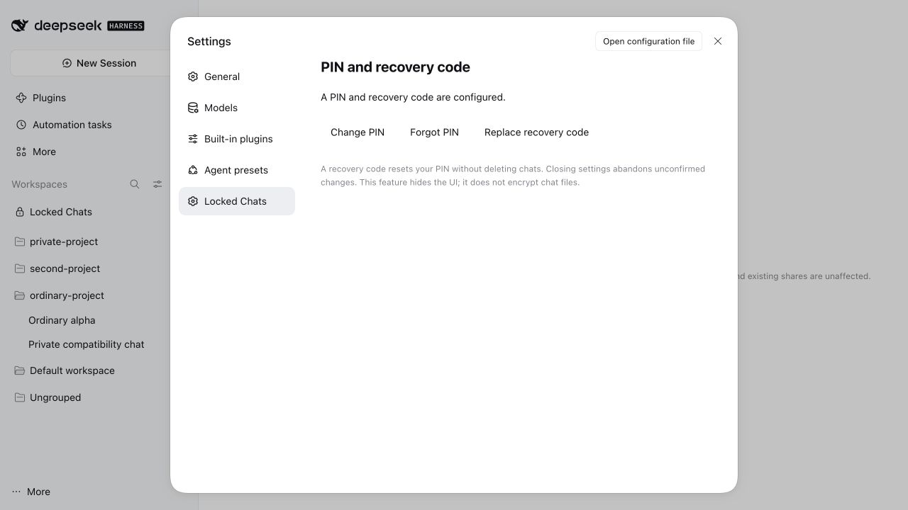
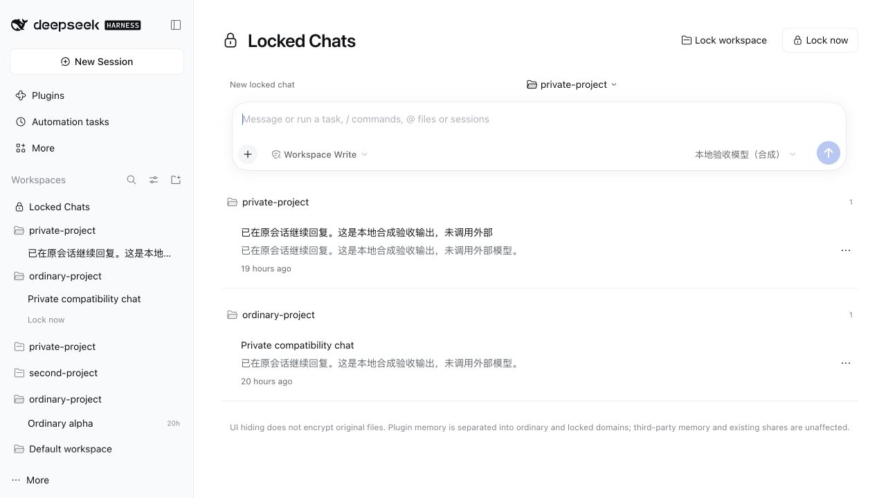
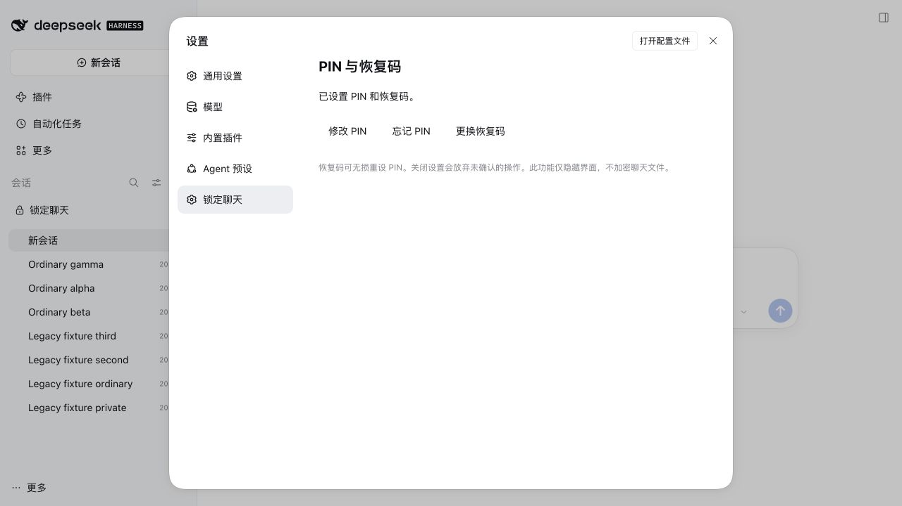

# v0.1.3: bilingual UI and current-release compatibility

English | [简体中文](RELEASE-0.1.3.zh-CN.md)

Date: 2026-10-25. This release packages the completed localization work. It does not implement a one-click updater or change DSH source.

## Versions and language

- At verification, official npm DSH `latest` was `0.2.1-rc.2` and `next` was `0.2.1-rc.3`; the latest [official prerelease](https://github.com/deepseek-ai/deepseek-harness/releases) was also rc.3. Unreleased main is not presented as a verified host release.
- Keep both supported hosts, without `*` or new host adaptation code.
- Plugin 0.1.3 ships English and Simplified Chinese navigation, settings, PIN/recovery, lock/unlock dialogs, errors, preview placeholders, relative times and accessibility labels.
- Choose English or Chinese under host **Settings → General → Language**. No separate English package is needed. User-authored titles/messages remain unchanged.
- The standalone settings page supports browser preferences and `?lang=en` / `?lang=zh`. Recovery behavior is unchanged.

## Verification in this release

| Scope | Result |
| --- | --- |
| Automated tests | 77 passed, zero failed in each rc.2/rc.3 interface environment; typecheck and build passed |
| Admission | Both actual host compatibility evaluators accepted the package without exemptions |
| Package upgrade | With isolated hosts stopped, official CLI overwrote 0.1.2 tgz installs in two existing test profiles with 0.1.3; no credential reset or chat-data recreation |
| rc.2 / rc.3 Web | Native language switch to English; existing credential status; original PIN automatically verifies at four digits; reopen old locked chat and continue through native composer; ordinary New Session does not reuse a vault draft |
| Additional rc.3 Web | Native chat-menu lock and English confirmation; ordinary-list hiding; no search result for a new private body marker; locked-group collapse/expand; flat view; changed drag order persisted after reload; switch back to Chinese |
| Browser console | No captured errors in either acceptance tab |
| Credentials/data | Browser checks cover original PIN and existing chats/lock records; recovery code was not modified. Automated tests cover recovery/forms/locale changes; browser acceptance did not reset PIN or consume a recovery code |

The final package was repacked after documentation edits. Its 27 runtime/manifest/patch files are byte-identical to the browser-tested package; only the two package READMEs and changelog changed. The release includes a checksum and machine-readable verification record.

All conversations were isolated synthetic fixtures with a local keyless model and no external model calls. Chinese fixture replies/model names are user/test content, not untranslated UI. Initial per-cell Playwright `fill` did not reliably drive the native PIN control; real keyboard input/paste succeeded, with keyboard auto-verification checked on both hosts.

## Actual screenshots

rc.3 English settings:

rc.3 English vault:

rc.3 switched back to Chinese:

Other evidence: [English PIN](assets/screenshots/v0.1.3/rc3-pin-en.png), [rc.3 continuation](assets/screenshots/v0.1.3/rc3-continue-en.png), [rc.2 settings](assets/screenshots/v0.1.3/rc2-settings-en.png), [rc.2 continuation](assets/screenshots/v0.1.3/rc2-continue-en.png).

## Installation and limits

[v0.1.3 Release](https://github.com/phao1/dsh-plugin-locked-chats/releases/tag/v0.1.3) · [Package](https://github.com/phao1/dsh-plugin-locked-chats/releases/download/v0.1.3/dsh-plugin-locked-chats-0.1.3.tgz)

Upgrading in the same Desktop profile/data directory should retain chats, locks, PIN and recovery code. See [installation](README.en.md). This run did not alter the user's running Desktop instance, update the DSH app or access production data.

Actual Desktop installation/upgrade remains unverified; Web is not Desktop acceptance. Dark theme and every native menu were not exhaustively retested. No custom updater helper/process or unreleased host update API is included. GitHub package delivery only; npm publication was not performed, and npm latest was 0.1.1 at lookup.

See [LOCALIZATION.en.md](LOCALIZATION.en.md) for the historical implementation and different-model review. Earlier browser restrictions describe that earlier session. No new Claude or other-model review was performed in this release turn.
