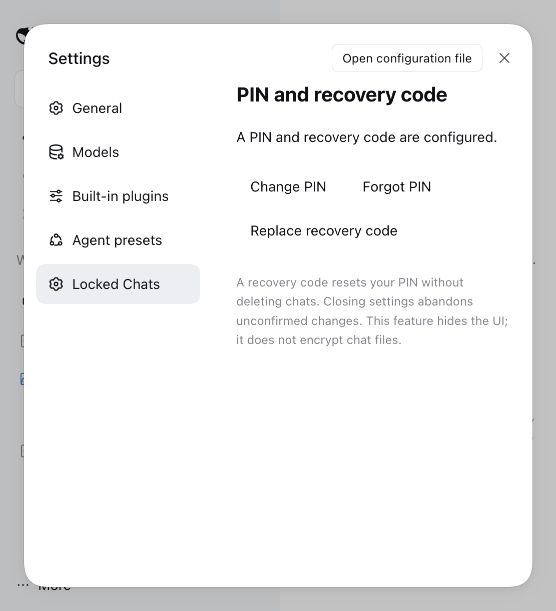
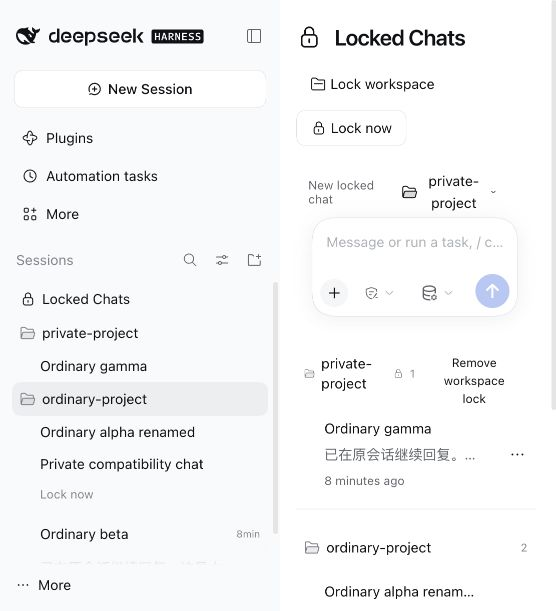

# v0.1.4: DSH rc.5 compatibility

English | [简体中文](RELEASE-0.1.4.zh-CN.md)

Date: 2026-11-03. Scope authorized by the user: pull current code, restore latest-host compatibility, and publish GitHub updates and merge the default branch. npm publication was subsequently deferred by the user. No new feature, host source change, or data migration is planned.

## Requirements and acceptance

- R1 / T1: accept official dsh 0.2.1-rc.5 through the real Host compatibility evaluator and connection peer; retain rc.2/rc.3, reject unverified releases and alpha builds. Demonstrate rejection before changing the manifest.
- R2 / T2: preserve plugin behavior. Run all behavioral tests, typecheck and build with each supported client-interface version; compare consumed public APIs between rc.3 and rc.5.
- R3 / T3: install the exact release tarball through the official CLI into an isolated real rc.5 Web Host. Upgrade a synthetic rc.3 / plugin 0.1.3 profile without resetting PIN, recovery or lock state; verify persistence after restart.
- R4 / T4: exercise browser lock/hiding, original-PIN unlock, continued conversation, ordinary New Session, search filtering, native groups/views/menu/drag persistence and both locales. Verify owner authentication and origin checks with the real Host. Recovery uses only disposable fixtures.
- R5 / T5: keep linked English/Chinese guides current; publish the audited tarball and checksum to GitHub. npm publication is deferred. Do not include local runtime data or credentials.

## Verification results

- **T1:** the official rc.5 evaluator rejected the original 0.1.3 manifest. After the fix, the actual rc.3 and rc.5 evaluators accept rc.2/rc.3/rc.5 without exemptions. Host and peer checks reject rc.1, rc.4, rc.6, stable 0.2.1, 0.2.2-alpha.2 and 0.3.0.
- **T2:** 77 tests passed in each rc.2, rc.3 and rc.5 dependency environment, with typecheck and build. A final clean locked installation passed all 77 tests. CI now runs all three versions and the admission check.
- **T3:** the official CLI upgraded a disposable rc.3 / plugin 0.1.3 profile to rc.5 / 0.1.4. Original PIN and recovery credential, explicit chat lock and workspace-inherited lock survive upgrade and another Host restart. Old window/access tokens are rejected. Recovery verification did not reset the upgrade fixture. A separate fresh rc.5 profile passed setup, recovery/reset, old-PIN/recovery revocation, cross-window rejection via the credential smoke script, which closes its test windows afterward.
- **T4:** browser checks passed for Chinese and English PIN auto-verification, existing private conversation continuation using the native composer, ordinary New Session, a newly entered private body marker excluded from search, visible public search results, native rename, menu-triggered locking and ordinary-list hiding, flat view, vault group collapse/expand, collapsed/expanded sidebar entry, and manual drag ordering persisting after reload. Replies use a local keyless synthetic model. Native owner authentication returned 401 anonymously and origin enforcement returned 403 for a foreign origin.
- **T5:** the final tarball contains only 31 allowlisted package files. All 26 runtime/typing/bundle-patch files are byte-identical to published 0.1.3. Only the manifest and public package documentation change. The final documentation-only repack was installed through a distinct checksum-named path to avoid pnpm's same-path cache; installed documentation was checked and real Host upgrade/recovery tests rerun. GitHub receives this same tarball and checksum. npm publication was explicitly deferred by the user.

## Interface audit and review

Official sources: [rc.5 release](https://github.com/deepseek-ai/deepseek-harness/releases/tag/dsh-v0.2.1-rc.5) and [rc.3 to rc.5 source comparison](https://github.com/deepseek-ai/deepseek-harness/compare/dsh-v0.2.1-rc.3...dsh-v0.2.1-rc.5), checked on 2026-11-03. npm latest and next were rc.5; alpha was 0.2.2-alpha.2 and is not supported.

Consumed source has no changes in connection/fetch registration, locale, slots, primitives, workspace/sidebar/layout/settings interfaces, session/workspace controllers, session retention, persistence, workspace registry, tools or system prompt. The conversation header changed tooltip presentation; the plugin continues to render it natively. This is a source audit plus real Host/browser verification, not a claim that TypeScript checks all JavaScript UI integrations.

A separate **gpt-6-astra** agent reviewed the maintenance scope and tests. Findings REV-01–04 required explicit old-profile upgrade verification, real Host auth/origin checks, native interactions, and consumed-API auditing; all were incorporated. REV-05 negative peer checks and REV-06 separate Desktop reporting were also accepted. The user authorized this compatibility fix and GitHub delivery, then explicitly deferred npm and requested merging the default branch. The actual default branch is `main`, not `master`; previous released rc.3/localization commits are also brought into main.

## Screenshots and limits

One native sidebar reference-cancellation error was captured during initial selection. All subsequent tested flows completed. An isolated in-memory experiment using the installed Host classes, with no plugin loaded, reproduced the same message when cancelling a pending sidebar selection; the original browser trigger was not independently reproduced. This is recorded as a non-blocking native diagnostic, not hidden or reported as a zero-error run.

Actual Desktop installation remains unverified. Web acceptance does not establish Desktop acceptance. Dark theme and all possible native menus were not exhaustively tested. No one-click updater, host modification, credential reset, or user production-data access was included. Existing UI-privacy limitations remain unchanged.

## Install

[v0.1.4 Release](https://github.com/phao1/dsh-plugin-locked-chats/releases/tag/v0.1.4) · [Installation package](https://github.com/phao1/dsh-plugin-locked-chats/releases/download/v0.1.4/dsh-plugin-locked-chats-0.1.4.tgz)

Use the Desktop plugin manager or the profile-specific command in the [guide](README.en.md). npm 0.1.4 was not published at the user's request.
