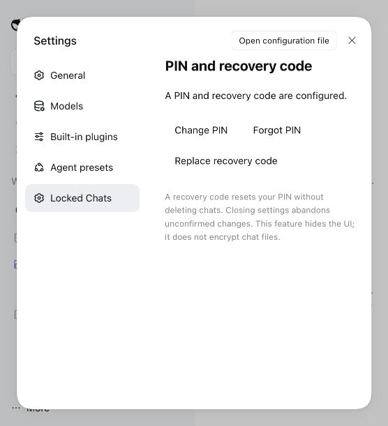
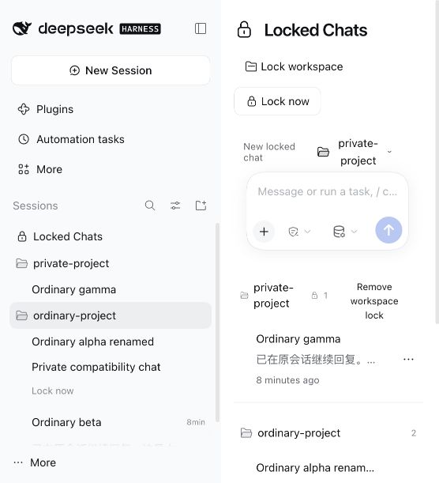

# v0.1.4：兼容 DSH rc.5

[English](RELEASE-0.1.4.en.md) | 简体中文

日期：2026-11-03。用户已授权：拉取最新代码、恢复最新版宿主兼容并更新 GitHub、合并默认主分支；用户随后明确暂停 npm。本轮不新增功能、不修改宿主源码、不迁移数据格式。

## 需求与验收

- R1 / T1：真实宿主兼容检查器和 connection peer 接受官方 dsh 0.2.1-rc.5；保留 rc.2/rc.3，拒绝未经验证的版本与 alpha。先证明旧声明会拒绝 rc.5。
- R2 / T2：保留插件行为。分别使用各受支持版本的真实客户端接口运行全量行为测试、类型检查和构建；对比 rc.3 与 rc.5 使用到的公开接口。
- R3 / T3：通过官方 CLI 在隔离的真实 rc.5 Web 宿主安装最终 tarball。从 rc.3 / 插件 0.1.3 合成测试环境升级，保留原 PIN、恢复码及锁定记录，并检查重启持久化。
- R4 / T4：浏览器验证锁定/隐藏、原 PIN 解锁、继续会话、普通新建、搜索过滤、原生分组/视图/菜单/拖拽持久化和中英文；真实宿主验证所有者认证及来源检查；恢复操作仅使用隔离数据。
- R5 / T5：同步互链中英文文档；将审查过的安装包和校验和发布到 GitHub，npm 暂停发布；禁止混入本地运行数据或凭据。

## 验收结果

- **T1：** 官方 rc.5 检查器首先复现旧 0.1.3 声明被拒绝。修复后，真实 rc.3 和 rc.5 检查器均无豁免地接受 rc.2/rc.3/rc.5。宿主和 peer 检查都拒绝 rc.1、rc.4、rc.6、正式 0.2.1、0.2.2-alpha.2 与 0.3.0。
- **T2：** rc.2、rc.3、rc.5 依赖环境各通过 77 项测试、类型检查和构建；最终锁定依赖干净安装后再次通过 77 项测试。CI 已覆盖三版及准入检查。
- **T3：** 官方 CLI 将隔离 rc.3 / 插件 0.1.3 profile 升级为 rc.5 / 0.1.4。原 PIN、恢复凭据、单聊锁、工作区继承锁在升级及再次重启后保留；旧窗口/访问令牌失效。恢复验证未重设升级夹具。在另一个全新 rc.5 profile 上，凭据脚本通过初始化、恢复重设、旧 PIN/恢复码撤销及跨窗口拒绝，最后关闭测试窗口。
- **T4：** 浏览器通过中英文 PIN 自动验证、原生输入框继续旧私密会话、普通新建、搜索排除新输入的私密正文标记、普通搜索有结果、原生改名、菜单锁定并从普通列表隐藏、平铺视图、保险箱分组收起/展开、折叠/展开侧栏入口、手动拖拽后刷新保持顺序。回复使用无密钥本地合成模型。真实宿主匿名访问返回 401、外域请求返回 403。
- **T5：** 最终包仅含白名单内 31 个文件；26 个运行产物、类型及 bundle patch 与已发布 0.1.3 逐字节一致，仅清单及公开包文档变化。文档最终重打包后，使用带校验和的不同文件路径避开 pnpm 同路径缓存，核对安装文档并重跑真实宿主升级/恢复测试。GitHub 使用同一 tarball 与校验和。按用户要求暂不发布 npm。

## 接口核对与评审

官方来源：[rc.5 发布说明](https://github.com/deepseek-ai/deepseek-harness/releases/tag/dsh-v0.2.1-rc.5)、[rc.3 至 rc.5 源码差异](https://github.com/deepseek-ai/deepseek-harness/compare/dsh-v0.2.1-rc.3...dsh-v0.2.1-rc.5)，核对日期 2026-11-03。npm latest/next 均为 rc.5；alpha 为 0.2.2-alpha.2，不在支持范围。

使用到的 connection/fetch 注册、locale、slots、primitives、工作区/侧栏/布局/设置接口、会话/工作区控制器、会话引用、持久化、工作区注册、工具与系统提示接口源码均无变化。会话标题栏修改了 tooltip 展示，插件仍复用原生渲染。结论来自源码核对及真实宿主/浏览器验收，不将 TypeScript 检查当作所有 JavaScript 集成的验证。

不同模型 **gpt-6-astra** agent 独立评审了维护范围和用例。REV-01–04 要求明确旧 profile 升级、真实宿主认证/来源、原生交互及消费接口核对，均已纳入；REV-05 peer 负向用例和 REV-06 桌面验收边界也已采纳。用户授权兼容修复和 GitHub 交付，随后明确暂停 npm 并要求合并主分支。实际默认分支是 `main`，不是 `master`；此前已发布的 rc.3 修复与本地化提交也一并纳入 main。

## 截图与限制

首次选择会话捕获一条原生侧栏引用取消错误，后续已验收流程均成功。使用已安装宿主类、不加载插件的内存隔离实验，可在取消未就绪的侧栏选择时复现同一日志；原始浏览器触发过程未独立复现。作为非阻塞原生日志记录，不屏蔽，也不声称控制台零错误。

真实桌面端安装仍未验收，Web 通过不等于桌面端通过。未穷尽深色主题及所有原生菜单。本轮不加入一键升级、不修改宿主、不重设用户凭据、不访问用户生产数据；原有界面隐私限制不变。

## 安装

[v0.1.4 Release](https://github.com/phao1/dsh-plugin-locked-chats/releases/tag/v0.1.4) · [安装包](https://github.com/phao1/dsh-plugin-locked-chats/releases/download/v0.1.4/dsh-plugin-locked-chats-0.1.4.tgz)

使用桌面插件管理界面或[指南](README.md)中的对应 profile 命令。按用户要求未发布 npm 0.1.4。
